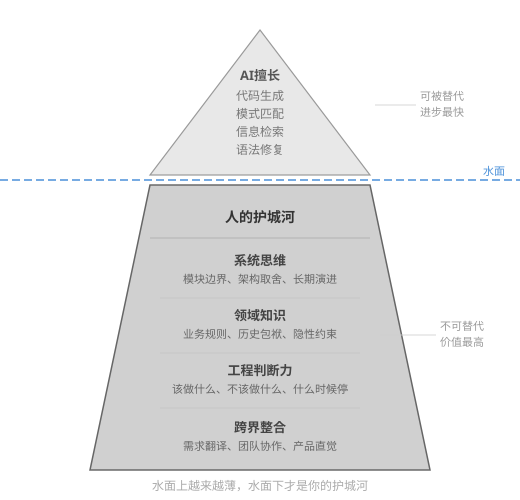
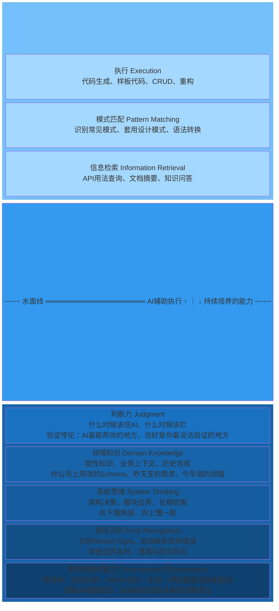
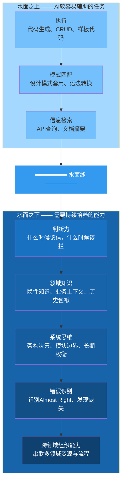

# AI时代的能力冰山模型 (Chapter 8, Section 8.1)

冰山图展示AI时代的能力分层：水面之上是AI较容易辅助的执行任务，水面之下是需要持续培养的判断力、领域知识、系统思维、错误识别与跨领域组织能力。这是能力结构的比喻，不代表人机能力的固定边界或比例。

## Mermaid 源码

## 替代方案：纵向流程图

## 关键洞察

- **水上部分**占冰山的一小部分，代表AI较容易辅助的执行任务，仍需按风险验证
- **水下部分**远大于水上，代表需要持续培养的深层能力，AI也可以辅助
- **瓶颈视角**：执行加速后，判断、架构与领域决策可能成为瓶颈；图形面积不表示能力占比或价值倍数
- **自检规则**：向下懂两层，向上懂一层
