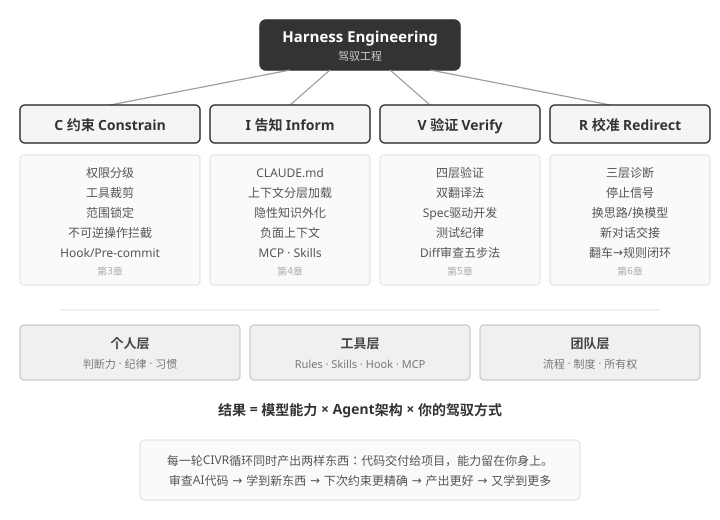
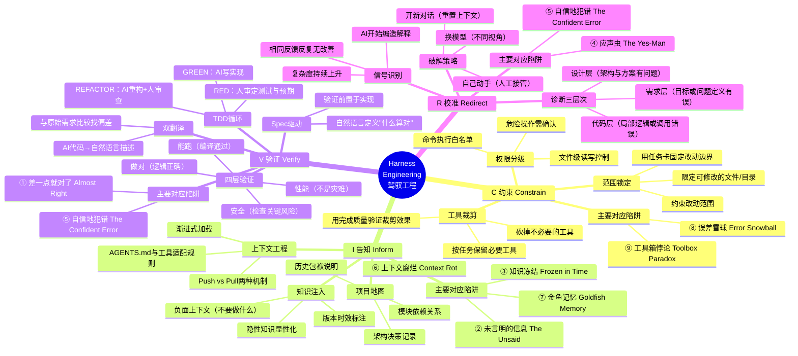
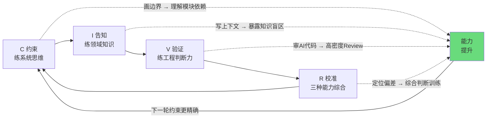

# CIVR框架全景图（全书框架速览）

全书核心CIVR框架的思维导图，中心为"Harness Engineering"，四个分支为约束、告知、验证、校准，每个分支展示关键子概念。作为读者合上书本前最后的记忆定格。

## Mermaid 源码

主要对应陷阱的编号与标签见[九陷阱对照表](pitfall-map.md)。一个问题通常需要组合使用多个动作。

独立测试会话可以读取需求、接口契约、输入输出结构和函数签名，避免先看实现再照着实现写断言。预期缺失时先列待确认项，由人审定。独立生成测试与“双翻译”是两种操作：双翻译将代码反述成自然语言，再与需求比较。

## CIVR与能力成长的飞轮

## 核心公式

**结果 = LLM x Agent架构 x 你的驾驭方式**

CIVR循环同时产出两样东西：**代码**交付给项目，**能力**留在你身上。
