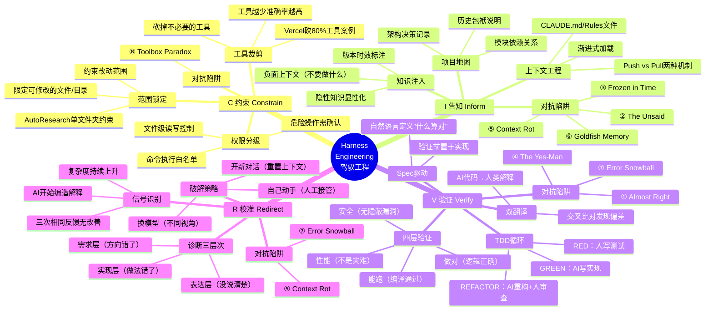
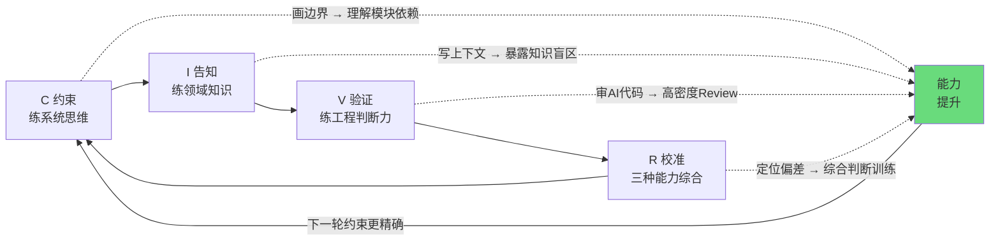

# CIVR框架全景图 (Chapter 8, Section 8.4)

全书核心CIVR框架的思维导图，中心为"Harness Engineering"，四个分支为约束、告知、验证、校准，每个分支展示关键子概念。作为读者合上书本前最后的记忆定格。

## Mermaid 源码

## CIVR与能力成长的飞轮

## 核心公式

**结果 = LLM x Agent架构 x 你的驾驭方式**

CIVR循环同时产出两样东西：**代码**交付给项目，**能力**留在你身上。
