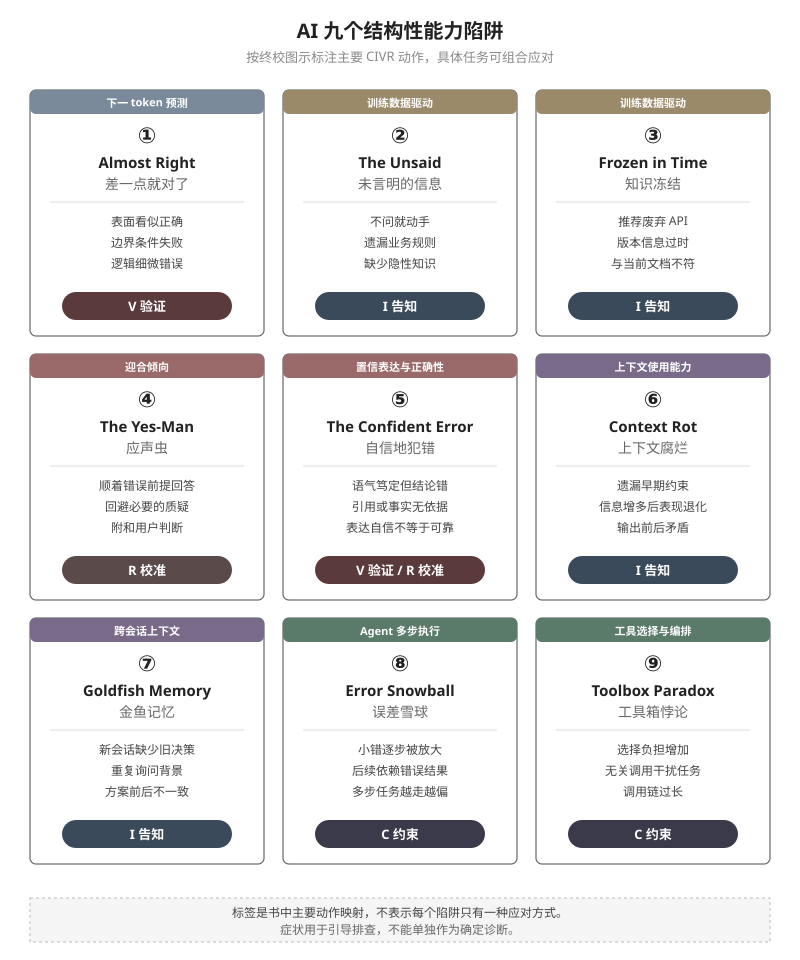
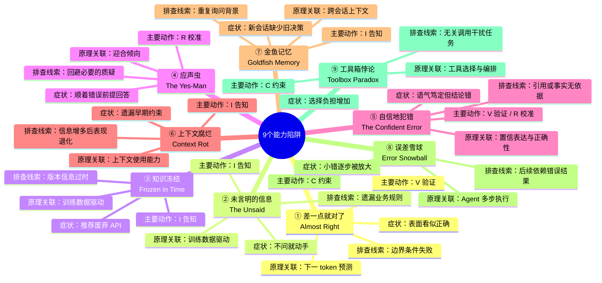

# AI能力陷阱总图（第1章）

本图展示9个AI结构性能力陷阱。名称、顺序及主要CIVR动作与书中终校图示一致。标签不是排他的应对方案；症状只能提供排查线索。

## Mermaid 源码

## 陷阱-CIVR对照表

| 陷阱 | 英文名 | 原理关联 | 典型症状与排查线索 | 主要CIVR动作 |
|------|--------|---------|-------------------|--------------|
| ① 差一点就对了 | Almost Right | 下一 token 预测 | 表面看似正确；边界条件失败；逻辑细微错误 | V 验证 |
| ② 未言明的信息 | The Unsaid | 训练数据驱动 | 不问就动手；遗漏业务规则；缺少隐性知识 | I 告知 |
| ③ 知识冻结 | Frozen in Time | 训练数据驱动 | 推荐废弃 API；版本信息过时；与当前文档不符 | I 告知 |
| ④ 应声虫 | The Yes-Man | 迎合倾向 | 顺着错误前提回答；回避必要的质疑；附和用户判断 | R 校准 |
| ⑤ 自信地犯错 | The Confident Error | 置信表达与正确性 | 语气笃定但结论错；引用或事实无依据；表达自信不等于可靠 | V 验证 / R 校准 |
| ⑥ 上下文腐烂 | Context Rot | 上下文使用能力 | 遗漏早期约束；信息增多后表现退化；输出前后矛盾 | I 告知 |
| ⑦ 金鱼记忆 | Goldfish Memory | 跨会话上下文 | 新会话缺少旧决策；重复询问背景；方案前后不一致 | I 告知 |
| ⑧ 误差雪球 | Error Snowball | Agent 多步执行 | 小错逐步被放大；后续依赖错误结果；多步任务越走越偏 | C 约束 |
| ⑨ 工具箱悖论 | Toolbox Paradox | 工具选择与编排 | 选择负担增加；无关调用干扰任务；调用链过长 | C 约束 |

原理关联是便于阅读的概括，不表示某个陷阱只由单一机制导致。
