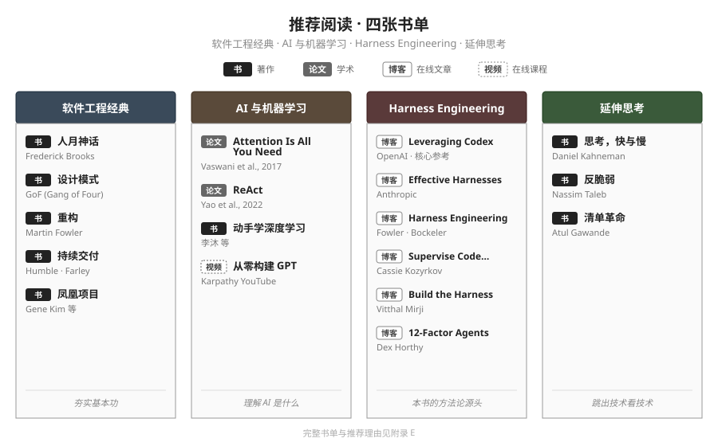

# 推荐阅读 (Appendix E)

本文件整理附录E的四类推荐书单，提取书名、作者与推荐理由。

## 软件工程经典

| 书名 | 作者 | 推荐理由 |
|------|------|----------|
| 《人月神话》 | Frederick Brooks | 软件工程奠基之作。Brooks定律至今适用——给延期项目加人手往往导致更严重的延期 |
| 《设计模式》 | GoF (Gang of Four) | AI可以辅助编写代码，但你需要知道该用哪种设计模式。这本书教的是思考方式 |
| 《重构》 | Martin Fowler | AI生成的代码常需重构。这本书教你识别代码中的"坏味道" |
| 《持续交付》 | Jez Humble, David Farley | DevOps的理论基础。理解部署流水线，才能真正理解Agent的验证闭环 |
| 《凤凰项目》 | Gene Kim等 | 以小说形式阐述DevOps核心原则，可读性强且实用 |

## AI与机器学习

| 书名/资源 | 作者 | 推荐理由 |
|-----------|------|----------|
| "Attention Is All You Need" | Vaswani et al., 2017 | Transformer的原始论文。无需完全读懂，但Figure 1和Section 3值得仔细阅读 |
| "ReAct: Synergizing Reasoning and Acting" | Yao et al., 2022 | Agent架构的理论基础 |
| 《动手学深度学习》 | 李沐等 | 中文世界最优质的深度学习入门书籍，配套B站视频教程 |
| Andrej Karpathy的YouTube频道 | Karpathy | 从零构建GPT系列视频，讲解深入浅出，强烈推荐 |

## Harness Engineering核心资源

| 资源 | 作者/来源 | 推荐理由 |
|------|----------|----------|
| "Harness Engineering: leveraging Codex" | OpenAI Blog | 3人团队编写百万行代码的完整经验分享，本书核心参考资料 |
| "Effective harnesses for long-running agents" | Anthropic | 长时运行Agent的实操指南 |
| "Harness Engineering" | Martin Fowler / Birgitta Bockeler | 最平衡的分析文章，指出了OpenAI博客中的盲区 |
| "How to Supervise Code You Can't Read" | Cassie Kozyrkov | 信任债务和双翻译习惯的原始出处 |
| "Build the Harness, Not the Code" | Vitthal Mirji | 面向Staff/Principal级工程师的实操手册 |
| 12-Factor Agents | Dex Horthy | 基于100+创始人访谈总结的Agent设计原则 |
| Claude Code系统提示词 | GitHub | 解析Claude Code如何设计约束和Skills |

## 延伸思考

| 书名 | 作者 | 推荐理由 |
|------|------|----------|
| 《思考，快与慢》 | Daniel Kahneman | 系统1（直觉）和系统2（理性）的框架。AI可视为极致的系统1——反应迅速但容易犯系统性错误 |
| 《反脆弱》 | Nassim Taleb | 优秀的系统不仅"不怕出错"，还能"从错误中变得更强"。Harness的校准循环正是反脆弱设计的体现 |
| 《清单革命》 | Atul Gawande | 探讨为什么简单的检查清单能挽救生命。本书每章末尾的Checklist设计受此书影响颇深 |
