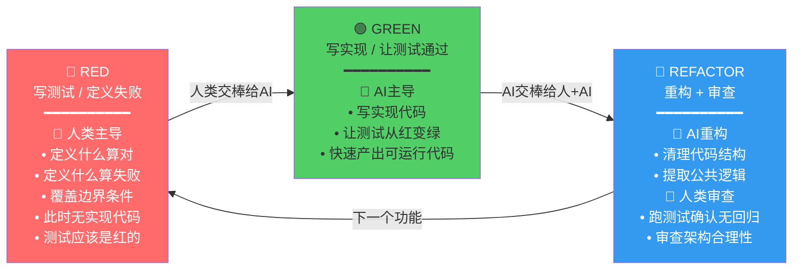
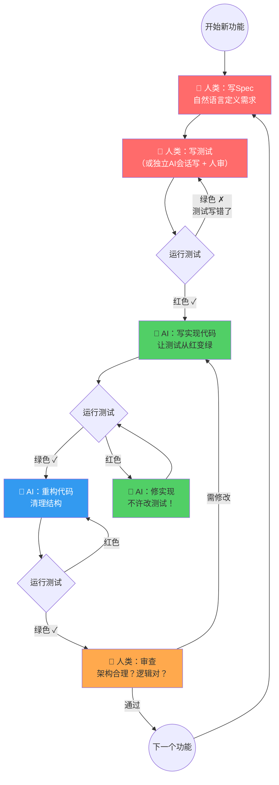

# AI时代的TDD循环 (Chapter 5, Section 5.8)

本图展示AI编程时代TDD循环的人机分工变化：RED-GREEN-REFACTOR三个阶段中，人类和AI各自承担不同角色。核心洞察：测试是人类定义"什么算对"的合同，AI负责让合同履行。


## Mermaid 源码



## 详细流程图



## 关键规则

| 阶段 | 谁主导 | 核心原则 |
|------|--------|---------|
| RED | 人类 | 测试和代码出自不同的脑子，偏差不会同步 |
| GREEN | AI | AI负责实现，测试失败时修代码而非改测试 |
| REFACTOR | AI + 人类 | AI擅长重构，人类确认无回归 |

## 保证测试质量的两种做法

1. **你自己写测试** -- 测试和代码出自不同脑子，偏差不会同步
2. **用独立会话或另一个AI写** -- 写测试的AI只看需求，不看实现代码（裁判和运动员不能是同一个人）

## CLAUDE.md验证规则（直接粘贴可用）

```
# 验证规则
- 禁止删除或修改已有测试用例，除非需求本身变更了测试预期
- 测试失败时，修代码，不许改测试
- 新增功能必须附带测试
- 代码必须能编译/运行，所有已有测试必须通过
```
