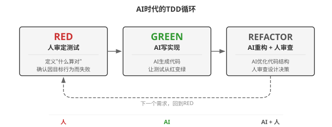
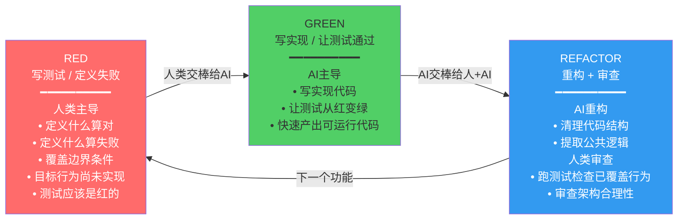
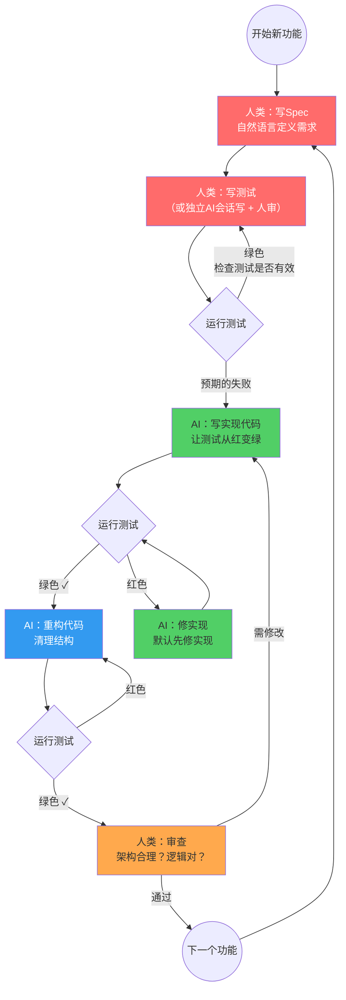

# AI时代的TDD循环 (Chapter 5, Section 5.8)

本图展示AI编程时代TDD循环的人机分工变化：RED-GREEN-REFACTOR三个阶段中，人类和AI各自承担不同角色。测试把需求的一部分转成可执行检查，由人审定预期，AI辅助实现。测试通过只证明已覆盖的检查通过。



## Mermaid 源码



## 详细流程图



## 关键规则

| 阶段 | 谁主导 | 核心原则 |
|------|--------|---------|
| RED | 人类 | 从需求独立设计测试，由人核对预期，降低共享盲区 |
| GREEN | AI | 默认修实现；若测试错误或需求变化，说明依据并确认后改测试 |
| REFACTOR | AI + 人类 | AI辅助重构，人类审查结构与未覆盖风险 |

## 提高测试独立性的两种做法

1. **你自己写测试** -- 对照需求审定断言，减少照着实现验证自身的风险
2. **用独立会话或另一个AI写** -- 测试会话读取需求、接口契约、输入输出结构与函数签名，避免先看实现；缺失预期先列待确认项，不能编造。会话独立仍需人审，不保证没有共享盲区

## AGENTS.md验证规则示例（按项目调整）

```
# 验证规则
- 测试失败默认先修实现；确需修改测试时，说明需求变化或测试错误并确认
- 不通过删除断言、放宽预期或跳过用例掩盖问题
- 为重要行为提供与风险相称的验证，覆盖关键边界和异常路径
- 报告实际运行的检查、结果及未覆盖范围，不把测试全绿等同于行为完全正确
```
