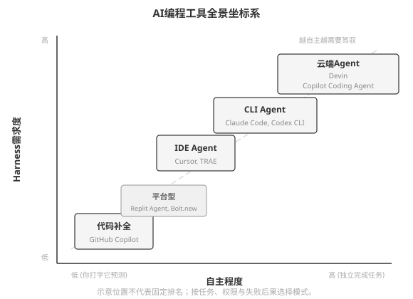
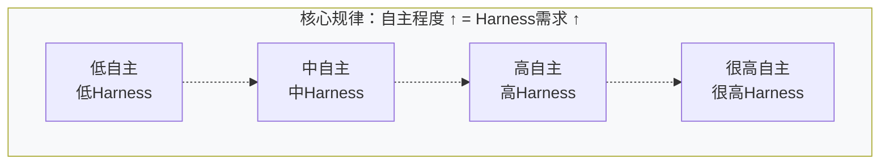
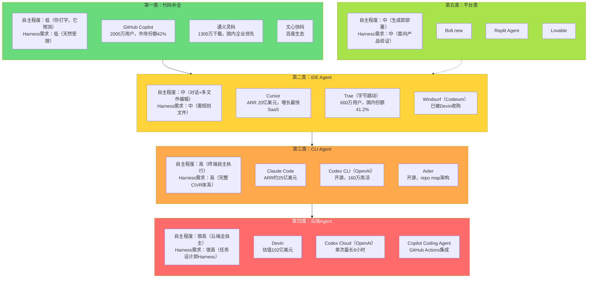

# AI编程工具全景图 (Appendix D)

本图展示AI编程工具按自主程度分类的全景坐标系，核心洞察：工具越自主，所需的Harness就越强。

## Mermaid 源码

## 工具全景对照表

| 工具类别 | 代表产品 | 自主程度 | Harness需求度 | 典型场景 | 上下文获取方式 |
|----------|----------|----------|--------------|---------|---------------|
| 代码补全 | Copilot、通义灵码、Tabnine | 低（你打字，它预测） | 低（天然受限） | 日常敲代码加速 | 当前文件 + 打开的Tab |
| IDE Agent | Cursor、Trae、Windsurf | 中（对话+多文件编辑） | 中（需规则文件） | 深度参与项目开发 | Embedding + 向量检索（预索引） |
| CLI Agent | Claude Code、Codex CLI、Aider | 高（终端自主执行） | 高（完整CIVR体系） | 复杂多步骤任务 | 按需搜索（ripgrep/glob/repo map） |
| 云端Agent | Devin、Codex Cloud、Copilot Agent | 很高（云端全自主） | 很高（任务设计即Harness） | 长时间自主作业 | 云端沙盒克隆仓库 |
| 平台类 | Bolt.new、Replit Agent、Lovable | 中（生成即部署） | 中（面向产品验证） | 快速原型、非工程师 | 平台内置环境 |

## 选择决策树

- 加速日常编码 --> Copilot / 通义灵码
- AI深度参与项目 --> Cursor / Trae
- 多步骤自主任务 --> Claude Code / Codex CLI
- 长时间自主执行 --> Devin / Codex Cloud（需确认：任务是否真的不需要中间干预？）
- 国内企业采购 --> 通义灵码（企业）/ Trae CN（个人）
