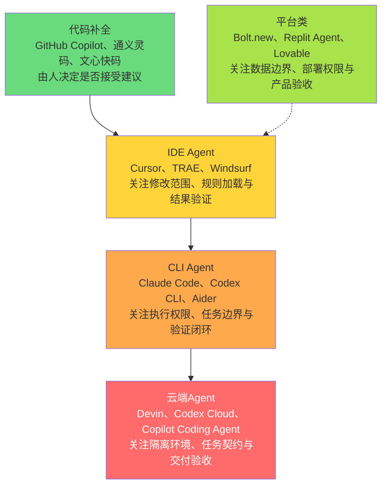

# AI编程工具全景图（附录D配套）

本图按常见使用方式区分工具，展示自主执行范围与Harness需求的关系。位置是教学示意，不是产品能力排名；同一产品可能提供多种模式，实际边界取决于所选模式、权限和运行环境。产品名沿用本配套的示例名，不提供实时价格、用户数或市场份额。

## Mermaid 源码

## 工具全景对照表

| 常见使用方式 | 代表产品 | 使用时重点检查 | 典型任务 |
|--------------|----------|----------------|----------|
| 代码补全 | GitHub Copilot、通义灵码、文心快码 | 建议是否符合当前上下文和业务规则 | 日常编码 |
| IDE Agent | Cursor、TRAE、Windsurf | 规则是否加载、改动范围是否合适 | 项目开发 |
| CLI Agent | Claude Code、Codex CLI、Aider | 命令权限、文件边界和验证证据 | 多步骤开发任务 |
| 云端Agent | Devin、Codex Cloud、Copilot Coding Agent | 环境隔离、契约完整性和交付验收 | 异步委派任务 |
| 平台类 | Bolt.new、Replit Agent、Lovable | 数据边界、部署权限和产物可维护性 | 原型与产品验证 |

SVG只列代表产品的子集，名称与本表一致。各类的上下文获取和权限实现因工具而异，不能仅凭类别推断其具体机制。

## 选择时先检查任务

- 只需补全：优先选择容易逐项审阅建议的模式。
- 需要跨文件修改：先准备项目上下文、明确可改范围和验收方式。
- 需要多步骤执行：确认权限边界、检查点和失败恢复方法。
- 需要异步委派：先写清任务契约、可用环境与交付证据。
- 需要产品原型：确认数据与部署边界，再验证关键用户流程。

自主执行范围越大，通常越需要明确的CIVR；验证深度还取决于失败后果，不能只看工具类别。
