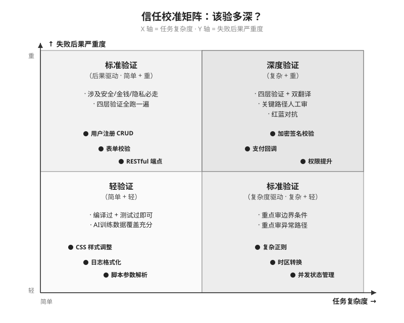
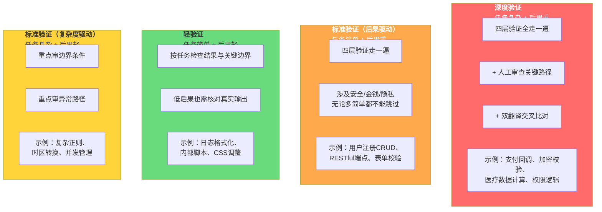

# 信任校准矩阵 (Chapter 5, Section 5.3)

本图展示验证深度的2x2决策矩阵。X轴为任务复杂度（AI做对的难度），Y轴为失败后果严重度。四个象限对应不同的验证策略。



## Mermaid 源码

```mermaid
quadrantChart
    title 信任校准矩阵：该验多深？
    x-axis 任务简单 --> 任务复杂
    y-axis 后果轻 --> 后果重
    quadrant-1 深度验证
    quadrant-2 标准验证(后果驱动)
    quadrant-3 轻验证
    quadrant-4 标准验证(复杂度驱动)
    支付回调处理: [0.85, 0.9]
    加密签名校验: [0.9, 0.95]
    权限提升逻辑: [0.8, 0.85]
    用户注册CRUD: [0.2, 0.8]
    表单校验逻辑: [0.25, 0.75]
    标准RESTful端点: [0.3, 0.7]
    复杂正则表达式: [0.75, 0.3]
    时区转换逻辑: [0.7, 0.25]
    并发状态管理: [0.8, 0.35]
    日志格式化函数: [0.15, 0.15]
    内部脚本参数解析: [0.2, 0.2]
    CSS样式调整: [0.1, 0.1]
```

## 四象限验证策略详解



## 三条使用规则

1. **后果严重度决定下限** -- 涉及安全、金钱、用户隐私的代码，无论任务多简单，最低标准验证
2. **任务复杂度增加验证需求** -- 复杂逻辑、边界和交互可能要求更深审查；熟悉的CRUD也不能免除高风险检查
3. **拿不准？升一级** -- 无法判断风险时先提高验证深度，再根据证据调整
